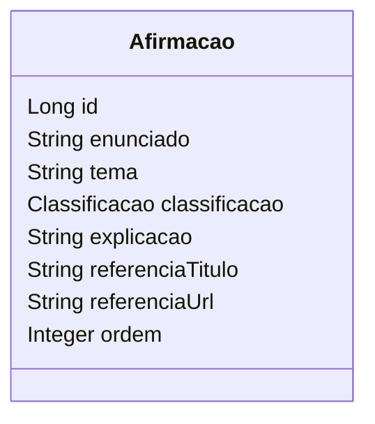

# REACTIO - Java Advanced / Sprint 1

API RESTful educativa do Desafio 1 AMAZUL: mitos, verdades e contexto sobre tecnologia nuclear. A proposta do produto usa microlições e trilha de aprendizagem inspiradas no Duolingo, com identidade própria e público de todas as faixas etárias. O backend entrega o conteúdo e o feedback; a interface mobile é uma entrega separada.

## Integrantes

| Nome | RM |
| --- | --- |
| Kayque | 567980 |
| Eric | 567398 |
| Gabriel | 567903 |

ADS, turmas de Agosto. **Turma: 2TDSPB.** Parceiro: AMAZUL / CTMSP - Marinha.

## O que foi desenvolvido

- CRUD completo de `Afirmacao` com Spring Data JPA.
- Busca parcial pelo enunciado com Query Method, ignorando maiúsculas/minúsculas.
- Quiz com `VERDADEIRO`, `FALSO` e `DEPENDE`; feedback sempre acompanhado de explicação e fonte.
- DTO do participante sem gabarito antes da resposta.
- Spring Validation, tratamento global de exceções e Swagger/OpenAPI.
- H2 persistido em arquivo, nove afirmações iniciais e testes de integração.

Não há login, ranking, IA, histórico, XP ou progresso persistido. A trilha visual e o avanço em tela pertencem ao aplicativo. A API fornece `tema` e `ordem` para sustentar essa experiência.

## Tecnologias

Java 17, Spring Boot 3.5.16, Spring Web, Spring Data JPA, Spring Validation, H2, springdoc-openapi 2.8.17, JUnit 5 e MockMvc. Projeto Maven. As versões das dependências estão fixadas no `pom.xml`. O Wrapper para Linux/macOS utiliza Maven 3.9.11.

## Executar

Requisito: **JDK 17 instalado**. A primeira execução exige internet para baixar as dependências.

### Pelo IntelliJ

1. Abra a pasta do projeto ou o arquivo `pom.xml` e aguarde a importação Maven.
2. Configure o SDK do projeto como JDK 17.
3. Abra a janela **Maven**. Em **Lifecycle**, execute `verify` para compilar e testar.
4. Para iniciar a API, execute o método `main` de `ReactioApplication` pelo botão Run.

O IntelliJ pode usar seu Maven integrado. Não é necessário ter o comando `mvn` disponível no terminal para executar dessa forma.

### Pelo terminal, com Maven instalado e disponível no PATH

Abra o terminal na pasta que contém `pom.xml`:

```bash
mvn clean verify
mvn spring-boot:run
```

No Linux/macOS, também permanece disponível o Wrapper:

```bash
sh mvnw clean verify
sh mvnw spring-boot:run
```

- Swagger UI: http://127.0.0.1:8080/swagger-ui.html
- OpenAPI JSON ao vivo: http://127.0.0.1:8080/v3/api-docs
- Quiz: http://127.0.0.1:8080/api/quiz
- Interromper: `Ctrl+C`.

Para executar o pacote gerado:

```bash
java -jar target/reactio-api-1.0.0.jar
```

A aplicação escuta somente `127.0.0.1` por padrão. Os endpoints editoriais não têm autenticação nesta sprint: destinam-se à demonstração local e exibem o gabarito. A separação de DTOs evita revelá-lo no fluxo do quiz, mas não é um mecanismo de controle de acesso. Para uma implantação pública, será necessário proteger a área editorial antes de expor a API.

### Configuração e persistência

| Variável | Padrão | Finalidade |
| --- | --- | --- |
| `PORT` | `8080` | Porta HTTP |
| `SERVER_ADDRESS` | `127.0.0.1` | Interface de rede |
| `DB_URL` | `jdbc:h2:file:./data/reactio` | Banco em arquivo relativo à pasta de execução |
| `DB_USER` | `sa` | Usuário do H2 local |
| `DB_PASSWORD` | vazio | Senha do H2 local |
| `SEED_ENABLED` | `true` | Habilita carga inicial se a tabela estiver vazia |

O banco fica em `data/`, ignorado pelo Git. Encerre e inicie na **mesma pasta** para reutilizar os dados. A carga não sobrescreve uma tabela com registros. Se todos forem excluídos, uma nova inicialização com carga habilitada repõe os exemplos; para manter a tabela vazia, defina `SEED_ENABLED=false`.

Os testes da API usam H2 em memória. Um teste adicional usa arquivo temporário sob target/ e fecha/reabre o contexto para conferir persistência. Todos usam bancos separados do banco da aplicação. `ddl-auto=update` é uma simplificação acadêmica; futuras alterações de schema devem usar migrações. Oracle não foi implementado: alinhar com o responsável por Banco de Dados antes de integrar os projetos. Na disciplina de DevOps, rede e volume persistente devem ser adaptados pelo responsável.

## Endpoints

| Método | Rota | Sucesso | Descrição |
| --- | --- | --- | --- |
| GET | `/api/afirmacoes?texto=...` | 200 | Conteúdo editorial com gabarito |
| GET | `/api/afirmacoes/{id}` | 200 | Consultar registro completo |
| POST | `/api/afirmacoes` | 201 + Location | Cadastrar |
| PUT | `/api/afirmacoes/{id}` | 200 | Substituir todos os dados editáveis |
| DELETE | `/api/afirmacoes/{id}` | 204 | Excluir |
| GET | `/api/quiz?texto=...` | 200 | Listar desafios sem gabarito |
| GET | `/api/quiz/{id}` | 200 | Consultar desafio sem gabarito |
| POST | `/api/quiz/{id}/respostas` | 200 | Responder e receber feedback |

A pesquisa usa `findByEnunciadoContainingIgnoreCaseOrderByOrdemAscIdAsc`. É uma busca por trecho no enunciado; não remove acentos. Espaços externos são ignorados. Texto ausente ou em branco lista tudo. Sem correspondências, retorna `[]`. Listas são ordenadas por `ordem`, com desempate por `id`. Sem paginação neste conjunto pequeno.

### Exemplo de cadastro

Use `examples/cadastro.json` no POST pelo Swagger ou:

```bash
curl -i -H "Content-Type: application/json" --data-binary @examples/cadastro.json http://127.0.0.1:8080/api/afirmacoes
```

No PowerShell, use `curl.exe` para evitar o alias de versões antigas. O JSON exige todos os campos:

```json
{
  "enunciado": "A radiação cósmica vem do espaço.",
  "tema": "Radiação no cotidiano",
  "classificacao": "VERDADEIRO",
  "explicacao": "Partículas energéticas produzidas pelo Sol e por estrelas contribuem para a radiação cósmica.",
  "referenciaTitulo": "EPA - Radiation Sources and Doses",
  "referenciaUrl": "https://www.epa.gov/radiation/radiation-sources-and-doses",
  "ordem": 10
}
```

### Exemplo de resposta

1. Consulte `/api/quiz` e escolha um ID existente.
2. Envie `{"resposta":"VERDADEIRO"}` para `/api/quiz/{id}/respostas`.
3. Observe `acertou`, `classificacaoCorreta`, `explicacao`, `referenciaTitulo` e `referenciaUrl`.

O campo `resposta` é um enum obrigatório, em maiúsculas. Valores numéricos, desconhecidos e campos JSON extras são rejeitados. Tentativas não alteram o conteúdo nem são armazenadas.

## Modelo de dados e arquitetura



`id` é a chave primária gerada. Não há relações nesta entidade isolada. `tema` é um rótulo; `ordem` representa a posição de apresentação e aceita empates. `classificacao` é persistida como texto. A referência identifica a fonte da explicação. São atributos suficientes para o ciclo educativo desta sprint, sem introduzir contas ou histórico.

| Campo | Regra |
| --- | --- |
| enunciado | Obrigatório, até 400 caracteres |
| tema | Obrigatório, até 80 |
| classificacao | VERDADEIRO, FALSO ou DEPENDE |
| explicacao | Obrigatória, até 1500 |
| referenciaTitulo | Obrigatório, até 200 |
| referenciaUrl | URL HTTPS válida, até 500 |
| ordem | Inteiro obrigatório maior que zero |

Strings obrigatórias não aceitam apenas espaços e são aparadas ao salvar. A validação da URL verifica formato e protocolo, não disponibilidade ou qualidade científica; a revisão editorial continua necessária.

Camadas: `api` recebe HTTP e valida DTOs; `service` aplica a comparação do quiz e controla transações; `repository` acessa JPA; `domain` representa o conteúdo; `config` carrega exemplos. `api/error` padroniza falhas. A entidade JPA não é exposta diretamente.

Erros usam `timestamp`, `status`, `mensagem`, `caminho` e `campos`. Casos principais: 400 para validação/formato, 404 para ID inexistente, 405 para método não aceito e 415 para tipo de conteúdo inadequado. Falhas inesperadas retornam 500 sem detalhes internos; o diagnóstico fica no log.

## Conteúdo e fontes

Nove afirmações de demonstração: cinco sobre radiação no cotidiano e quatro sobre aplicações em alimentos, cobrindo as três classificações. Estão em `src/main/resources/dados-iniciais.json`. O uso de `DEPENDE` exige explicitar as condições que alteram a conclusão.

- [EPA - Radiation Sources and Doses](https://www.epa.gov/radiation/radiation-sources-and-doses)
- [FDA - Food Irradiation: What You Need to Know](https://www.fda.gov/food/buy-store-serve-safe-food/food-irradiation-what-you-need-know)

Consultadas em 27/10/2026. O texto é uma síntese educativa das fontes. Antes de cadastrar conteúdo novo, revisar afirmação, classificação, explicação e aderência da referência.

## Testes e demonstração

Execute `clean verify`. A suíte verifica o CRUD, busca textual, ordenação, ausência de gabarito no quiz, feedback correto/incorreto/DEPENDE, campos e URL inválidos, JSON e enum inválidos, IDs inexistentes, contratos de erro, OpenAPI carga inicial sem duplicação e persistência em arquivo após fechar/reabrir a aplicação. Não há mocks de negócio: os testes exercitam controllers, serviço, JPA e H2. Os listeners de teste são limitados à injeção de dependências para não exigir instrumentação de mocks.

Roteiro de demonstração em `docs/roteiro-demonstracao.md`; evidências em `docs/VERIFICACAO.md`.

## Conferência da entrega Java

- [x] Código-fonte e configurações
- [x] README e .gitignore
- [x] JPA com CRUD completo
- [x] Pesquisa por Query Method
- [x] Spring Validation e tratamento global de exceções
- [x] Swagger/OpenAPI e dados de teste
- [x] Turma: 2TDSPB
- [ ] Publicar o conteúdo desta pasta em repositório público no GitHub e conferir acesso sem login
- [ ] Enviar o link público no portal FIAP

A publicação e o envio não foram realizados automaticamente. Não é exigido vídeo na seção de Java Advanced. A PoC .NET deve ter responsabilidade complementar, acordada com o colega.
